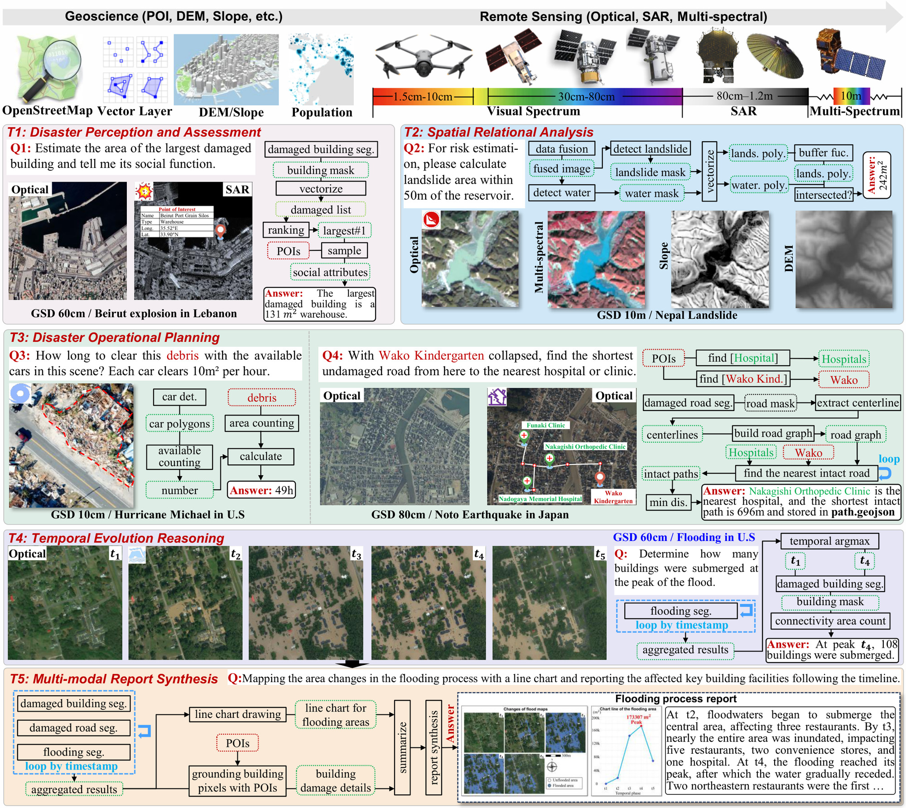
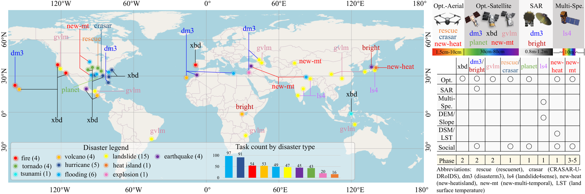
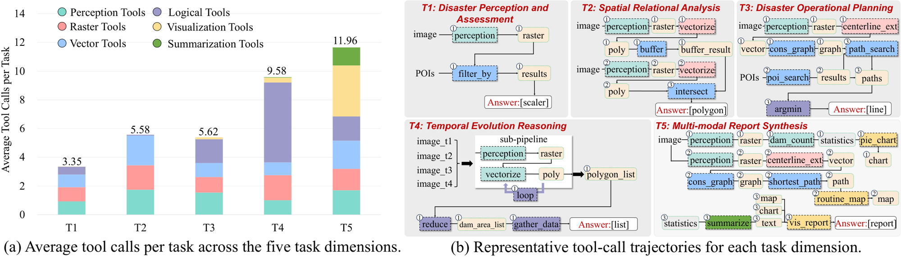
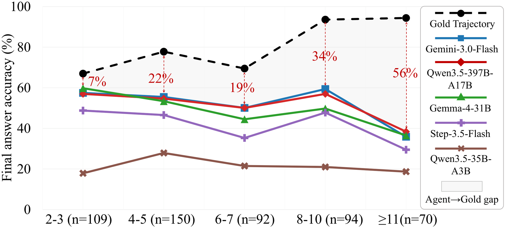

<h2 align="center">
  
  DORA: Can LLM Agents Respond to Disasters? Benchmarking Heterogeneous Geospatial Reasoning in Emergency Operations
</h2>

<h5 align="center"><a href="https://junjuewang.top/">Junjue Wang*</a>,
<a href="https://weihaoxuan.com">Weihao Xuan*</a>,
Heli Qi, Pengyu Dai, Kunyi Liu, <a href="https://chrx97.com/">Hongruixuan Chen</a>,
<a href="https://zhuozheng.top/">Zhuo Zheng</a></h5>
<h5 align="center">
Junshi Xia, <a href="https://cs.stanford.edu/~ermon/">Stefano Ermon</a>, <a href="https://naotoyokoya.com/">Naoto Yokoya†</a></h5>

<h5 align="center">
* Equal Contributions
† Corresponding Author</h5>

[[`Paper`](https://arxiv.org/abs/2605.11633)],
[[`Dataset`](https://huggingface.co/datasets/Kingdrone-Junjue/DORA)]

<div align="center">
  
</div>

## Highlights

DORA (**D**isaster **O**perational **R**esponse **A**gent benchmark) includes 515 expert-authored tasks across 45 real-world disaster events of 10 types on 5 continents, paired with expert-verified, replayable gold trajectories totaling 3,500 tool-call steps, with three characteristics:

1. Operational: 5 analytical dimensions that follow the disaster-response pipeline, i.e., disaster perception and assessment, spatial relational analysis, disaster operational planning, temporal evolution reasoning, and multi-modal report synthesis, each grounded in UNOSAT, Copernicus EMS, FEMA and UN OCHA protocols
2. Heterogeneous: optical, SAR and multi-spectral imagery across single-, bi- and multi-temporal sequences (0.015–10 m GSD), complemented by DEM, slope, land surface temperature and social vector layers (POIs, road networks, population, facility footprints)
3. Agentic: agents compose calls from a 108-tool MCP library (perception, raster, vector, logical, visualization, summarization), and are evaluated on both tool-call trajectories and final answers

<div align="center">
  
</div>

## News

- 2026/10/17, The data and perception checkpoints are released on [Hugging Face](https://huggingface.co/datasets/Kingdrone-Junjue/DORA).
- 2026/10/10, DORA v1.1 updates the task specifications and the evaluator; the leaderboard is updated to v1.1.
- 2026/09/29, Code, the 108-tool MCP library, the data preparation script and the evaluator are released. The data and perception checkpoints are coming soon.
- 2026/09/25, Our paper got accepted by NeurIPS 2026 (Evaluations & Datasets Track) as an **oral** presentation.
- 2026/05/12, Our paper is available on [arXiv](https://arxiv.org/abs/2605.11633).

## Benchmark

### Task taxonomy

| Dimension                                 | #Tasks | Avg. steps | Operational protocol                 |
|:----------------------------------------- |:------:|:----------:|:------------------------------------ |
| T1: Disaster Perception & Assessment (PA) | 132    | 3.35       | UNOSAT Rapid Mapping, Copernicus EMS |
| T2: Spatial Relational Analysis (SR)      | 108    | 5.58       | FEMA Hazus                           |
| T3: Disaster Operational Planning (OP)    | 100    | 5.62       | FEMA Urban Search and Rescue (US&R)  |
| T4: Temporal Evolution Reasoning (TE)     | 61     | 9.58       | Copernicus EMS Monitoring            |
| T5: Multi-modal Report Synthesis (RS)     | 114    | 11.96      | UN OCHA Situation Reports, IFRC      |

<div align="center">
  
</div>

### Tool library

All tools are implemented as MCP servers with a uniform JSON-RPC interface and typed input/output schemas, so any MCP-compatible agent framework can be evaluated without modification.

| Category      | #Tools | Representative tools                                         |
|:------------- |:------:|:------------------------------------------------------------ |
| Perception    | 31     | `seg.building_damage`, `seg.flood`, `seg.road_damage`        |
| Raster        | 18     | `ras.area`, `ras.diff`, `ras.vectorize`                      |
| Vector        | 31     | `vec.intersect`, `vec.shortest_path`, `poi.filter_by_damage` |
| Logical       | 15     | `logi.loop`, `logi.reduce`                                   |
| Visualization | 11     | `vis.damage_map`, `vis.route_map`, `vis.report_page`         |
| Summarization | 2      | `m.extract_evidence`, `m.summarize`                          |

In the code, `logi.loop`/`logi.reduce` are `tool.loop`/`tool.reduce`, and `m.extract_evidence`/`m.summarize` are `report.extract_evidence`/`model.summarize`.

### Leaderboard

#### DORA v1.1

Final-answer accuracy (%) and trajectory metrics on DORA v1.1 (data and evaluator). Agent runs on v1.1 will be added here.

| Model                        | Type        | AVG       | T1 (PA)   | T2 (SR)   | T3 (OP)   | T4 (TE)   | T5 (RS)   | T-Any-O   | T-In-Ord  | T-Exact-M | ParAcc    | Eff       |
|:---------------------------- |:----------- |:---------:|:---------:|:---------:|:---------:|:---------:|:---------:|:---------:|:---------:|:---------:|:---------:|:---------:|
| Gold Trajectory              | Oracle      | 83.17     | 75.58     | 74.88     | 83.93     | 92.73     | 88.75     | 100.00    | 100.00    | 100.00    | 100.00    | 100.00    |

Gold Trajectory is defined as in the paper (see below) and runs with the v1.1 tools and the released checkpoints; its trajectory metrics are 100 by definition.

T-Any-O, T-In-Ord and T-Exact-M are Tool-Any-Order, Tool-In-Order and Tool-Exact-Match; ParAcc is Parameter Accuracy; Eff is efficiency, |gold steps| / max(|steps|, |gold steps|). All values are %, higher is better.

v1.1 scores are not directly comparable with the v1.0 table below, since v1.1 updated the task specifications, gold answers, tools and evaluator.

#### DORA v1.0 (paper, Table 4)

Final-answer accuracy (%) and trajectory metrics of 13 LLM agents under a ReAct-style loop. The best agent result in each column is in **bold**. To reproduce the paper, use the v1.0 release: `git checkout v1.0` (its `prepare_data.py` downloads data v1.0).

| Model                        | Type        | AVG       | T1 (PA)   | T2 (SR)   | T3 (OP)   | T4 (TE)   | T5 (RS)   | T-Any-O   | T-In-Ord  | T-Exact-M | ParAcc    | Eff       |
|:---------------------------- |:----------- |:---------:|:---------:|:---------:|:---------:|:---------:|:---------:|:---------:|:---------:|:---------:|:---------:|:---------:|
| Gold Trajectory              | Oracle      | 80.48     | 71.31     | 63.19     | 83.63     | 90.77     | 93.50     | 100.00    | 100.00    | 100.00    | 100.00    | 100.00    |
| Gemini-3.0-Flash             | Commercial  | **53.74** | 54.19     | 49.00     | **59.82** | 60.40     | 45.31     | 75.17     | 66.57     | **35.55** | **42.63** | 83.05     |
| Qwen3.5-397B-A17B            | Open-source | 53.45     | 51.03     | **53.40** | 51.82     | 61.83     | **49.17** | 75.44     | 66.97     | 32.13     | 36.50     | 76.54     |
| MiMo-V2-Pro                  | Open-source | 52.89     | 53.68     | 47.43     | 55.48     | **63.58** | 44.26     | 74.05     | **67.13** | 34.24     | 38.45     | 79.11     |
| Grok-4.1-Fast                | Commercial  | 52.10     | 53.07     | **53.40** | 54.23     | 55.28     | 44.52     | 59.15     | 53.19     | 28.09     | 31.96     | 86.83     |
| Claude-Sonnet-4.6            | Commercial  | 52.01     | **54.43** | 48.23     | 51.82     | 60.05     | 45.53     | **76.29** | 66.92     | 32.28     | 39.48     | 75.32     |
| Gemma-4-31B                  | Open-source | 51.17     | 51.46     | 49.00     | 52.33     | 61.03     | 42.03     | 69.89     | 62.58     | 32.82     | 38.23     | 86.43     |
| MiniMax-M2.7                 | Open-source | 48.35     | 51.87     | 48.53     | 50.16     | 50.59     | 40.62     | 62.89     | 55.19     | 25.32     | 29.68     | 79.33     |
| DeepSeek-V3.2                | Open-source | 48.23     | 49.80     | 49.15     | 50.57     | 50.62     | 41.01     | 74.26     | 65.99     | 30.39     | 34.69     | 72.44     |
| GPT-5.4                      | Commercial  | 47.63     | 52.85     | 50.80     | 53.50     | 51.90     | 29.11     | 66.84     | 59.43     | 31.82     | 37.71     | 88.46     |
| Step-3.5-Flash               | Open-source | 46.68     | 49.70     | 44.91     | 48.33     | 48.90     | 41.58     | 62.59     | 55.91     | 25.33     | 29.43     | 78.29     |
| GPT-5.4-Nano                 | Commercial  | 38.14     | 44.40     | 33.41     | 39.98     | 45.55     | 27.37     | 54.96     | 49.06     | 21.81     | 27.02     | 84.36     |
| GPT-OSS-120B                 | Open-source | 35.11     | 42.70     | 37.58     | 42.00     | 24.43     | 28.84     | 48.69     | 43.60     | 22.79     | 26.24     | **90.42** |
| Qwen3.5-35B-A3B              | Open-source | 24.01     | 14.15     | 13.89     | 33.08     | 37.62     | 21.30     | 55.20     | 48.91     | 23.10     | 27.08     | 80.39     |
| Gemini-3.0-Flash (w/o tools) | VLM         | 18.55     | 5.98      | 19.91     | 17.48     | 29.36     | 20.03     | –         | –         | –         | –         | –         |
| Qwen3-VL-235B (w/o tools)    | VLM         | 18.30     | 5.53      | 28.63     | 12.63     | 27.75     | 16.95     | –         | –         | –         | –         | –         |

Gold Trajectory executes the expert-authored tool sequence with model-backed perception tools (not ground-truth masks), so it is a planning-and-argument oracle rather than a perfect-answer oracle.

Three persistent challenges:

1. Disaster-domain grounding exposes unique failure modes: damage-semantic grounding, sensor-modality mismatch and disaster-pipeline composition
2. Agents are doubly bottlenecked by tool selection and argument grounding: gold tool-order hints improve accuracy by only 1.08–4.40%, and alternative scaffolds yield at most a 3.24% gain
3. Compositional fragility scales with trajectory length: the agent-to-gold gap widens from 7% to 56% on long pipelines

<div align="center">
  
</div>

### Data format

Each task is a tuple of a query (Q), a heterogeneous data manifest (D), a gold tool-call trajectory (T) and a structured final answer (A), stored as a JSON meta file. A simplified example:

```text
{
  sample_id: "la_palma_volcano_00000516",
  question: "How many buildings have been totally destroyed by the volcanic activity in this area?",
  input_data: {
    pre_image:  {image_path: "la_palma_volcano_00000516_pre_disaster.tif",      modality: "optical", pixel_size_m: 0.3, spatial_coordinate_system: "EPSG:32628", band_info: ["R", "G", "B"]},
    post_image: {image_path: "la_palma_volcano_00000516_sar_post_disaster.tif", modality: "sar",     pixel_size_m: 0.3, spatial_coordinate_system: "EPSG:32628", band_info: ["SAR"]}
  },
  trajectory: [
    {call: "seg.building_damage_opt_sar",
     args: {pre_image_path: "la_palma_volcano_00000516_pre_disaster.tif", post_image_path: "la_palma_volcano_00000516_sar_post_disaster.tif"},
     obs:  {mask_path: "la_palma_volcano_00000516_building_damage.tif", classes: {1: "intact", 2: "partially damaged", 3: "totally destroyed"}}},
    {call: "ras.vectorize",
     args: {mask_path: "la_palma_volcano_00000516_building_damage.tif", classes: [3], pixel_size_m: 0.3},
     obs:  {count: 67, total_area_m2: 8020.44, ...}}
  ],
  answer: {destroyed_building_count: 67, destroyed_building_total_area_m2: 8020.44}
}
```

## Installation

Python 3.11 on Linux, Windows or macOS; the perception tools want a CUDA GPU with 12 GB or more
(they fall back to the CPU, slowly). The environment is fully pinned (`requirements.txt`, resolved
from `pyproject.toml`); install PyTorch first for your CUDA version.

```bash
conda create -n dora python=3.11 -y && conda activate dora     # or: uv venv --python 3.11
pip install torch==2.11.0 torchvision==0.26.0 --index-url https://download.pytorch.org/whl/cu128
pip install -r requirements.txt
pip install -e . --no-deps
```

GDAL, PROJ and GEOS come with the `rasterio`/`pyogrio`/`shapely` wheels; no system packages are needed.

## Data

The Hugging Face dataset asks for a short access form (name, affiliation, email; granted
automatically): request access on the [dataset page](https://huggingface.co/datasets/Kingdrone-Junjue/DORA),
then log in once with `hf auth login` (or set `HF_TOKEN`) using a Read token; a fine-grained token
needs "Read access to contents of all public gated repos you can access". One command downloads the tasks, source
layers and perception checkpoints (~18 GB) into `./data` and verifies every file against the release
manifest:

```bash
python scripts/prepare_data.py                    # Hugging Face (default); --source <dir> for a local copy
python scripts/prepare_data.py --no-checkpoints   # skip the perception weights (~12.7 GB): enough to score runs with evaluate.py, not to run the agents
python scripts/prepare_data.py --gvlm /path/to/GVLM   # GVLM from a local copy (default: its official archive)
python scripts/prepare_data.py --rescuenet /path/to/RescueNet   # RescueNet originals from a local copy (default: figshare)
```

```text
data/
├── tasks/          t1_perception_and_assessment.json ... t5_multi_modal_report_synthesis.json
├── images/         imagery, DEM/DSM, SAR and vector layers referenced by the tasks
├── checkpoints/    perception model weights (*.safetensors)
└── manifest.json   size and SHA-256 of every file
```

Keep the data elsewhere with `export DORA_DATA=/path/to/data`. Each task is a JSON record with the
question, an `input_data` manifest (paths relative to `images/`), the expert tool plan, the executed
gold trajectory, the final answer and its `eval_spec`.

## Running an agent

```bash
# check data, checkpoints and the 108 MCP tools (no API key needed)
python scripts/run_benchmark.py --model configs/models/gemini-3-flash.json --dry-run

export GOOGLE_API_KEY=...        # agent model; also used by the report tools of T5 (Gemini 3 Flash)
python scripts/run_benchmark.py --model configs/models/gemini-3-flash.json               # all tasks, AP
python scripts/run_benchmark.py --model configs/models/gemini-3-flash.json --tasks t1 t3 --workers 2 --gpus 0,1
python scripts/run_benchmark.py --model configs/models/gemini-3-flash.json --mode if     # gold tool order given
```

The agent is a LangGraph ReAct loop over the tools, which run as six MCP servers
(`dora/tools/{analysis,calculate,perception,vis,model,poi}.py`). Answers and trajectories are written
to `outputs/<model>_<MODE>/<task>/benchmark.jsonl`; interrupted runs continue with `--resume`.

`configs/models/` holds the settings of the leaderboard models. Models served through OpenRouter read
`OPENROUTER_API_KEY`, OpenAI models `OPENAI_API_KEY`, Azure models `AZURE_OPENAI_API_KEY` and
`AZURE_OPENAI_ENDPOINT`. To add a model, copy a config and change `provider`
(`gemini`, `openai` for any OpenAI-compatible endpoint with `base_url`, or `azure`) and `model`.

`m.summarize` answers with Gemini 3 Flash. `export DORA_SUMMARIZE_MODEL=<model>` (e.g. `anthropic/claude-opus-5.5`)
makes another model answer it: a GPT or Gemini model through its own API, any other model through OpenRouter
(`OPENROUTER_API_KEY`; another OpenAI-compatible endpoint with `DORA_SUMMARIZE_BASE_URL` and `DORA_SUMMARIZE_API_KEY`).

## Evaluation

```bash
python scripts/evaluate.py --run outputs/gemini-3-flash_AP     # writes outputs/gemini-3-flash_AP/eval.json(.txt)
python scripts/evaluate.py --sanity                            # gold vs gold: every metric is 1.0
```

Final answers are scored per field by type (scalar closeness `|ŷ−y| ≤ 1 + 0.2|y|`, exact match, set F1,
dict of scalars, ranking Kendall τ, point distance, polygon IoU), averaged per task, per dimension and
over the five dimensions (DORA score). Trajectories are scored with Tool-Any-Order, Tool-In-Order,
Tool-Exact-Match, Parameter Accuracy and Efficiency.

## Repository structure

```text
dora/
├── benchmark.py        task files -> agent questions
├── agent/              LLM factory, prompts, MCP tool pool, ReAct runner
├── tools/              the six MCP tool servers (108 tools)
│   └── segmentation/   perception models (DINOv3+DPT, SegFormer, Swin-UPerNet, HRNet) and sliding-window inference
├── evaluation.py       answer and trajectory metrics
└── paths.py            data layout (DORA_DATA)
scripts/                prepare_data.py, run_benchmark.py, evaluate.py
configs/models/         leaderboard model settings (no secrets)
```

## Citation

If you use DORA in your research, please cite our following papers.

```text
@inproceedings{wang2026dora,
  title={Can LLM Agents Respond to Disasters? Benchmarking Heterogeneous Geospatial Reasoning in Emergency Operations},
  author={Wang, Junjue and Xuan, Weihao and Qi, Heli and Dai, Pengyu and Liu, Kunyi and Chen, Hongruixuan and Zheng, Zhuo and Xia, Junshi and Ermon, Stefano and Yokoya, Naoto},
  booktitle={Proceedings of the Neural Information Processing Systems},
  year={2026}
}

@inproceedings{wang2025disasterm3,
  title={DisasterM3: A Remote Sensing Vision-Language Dataset for Disaster Damage Assessment and Response},
  author={Wang, Junjue and Xuan, Weihao and Qi, Heli and Liu, Zhihao and Liu, Kunyi and Wu, Yuhan and Chen, Hongruixuan and Song, Jian and Xia, Junshi and Zheng, Zhuo and Yokoya, Naoto},
  booktitle={Proceedings of the Neural Information Processing Systems},
  year={2025}
}
```

## License

- **Code**: [Apache-2.0](LICENSE). Vendored code keeps its license: DINOv3 (`dora/tools/segmentation/dinov3`, DINOv3 License) and SegFormer (`dora/tools/segmentation/segformer`, NVIDIA Source Code License, non-commercial).
- **DORA annotations** (tasks, gold trajectories, answers): [CC BY-NC-SA 4.0](https://creativecommons.org/licenses/by-nc-sa/4.0/), non-commercial use.

<a rel="license" href="https://creativecommons.org/licenses/by-nc-sa/4.0/deed.en">
</a>

## Star History

<a href="https://www.star-history.com/?type=date&repos=Junjue-Wang%2FDORA">
 <picture>
   <source media="(prefers-color-scheme: dark)" srcset="https://api.star-history.com/chart?repos=Junjue-Wang/DORA&type=date&theme=dark&legend=top-left" />
   <source media="(prefers-color-scheme: light)" srcset="https://api.star-history.com/chart?repos=Junjue-Wang/DORA&type=date&legend=top-left" />
   
 </picture>
</a>
